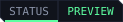

<p align="center">
  
</p>

<p align="center">
  <a href="https://edgemodders.github.io/REDcode/"></a>
  
  
  
  <a href="LICENSE"></a>
</p>

A Cyberpunk 2077 modding IDE built on VS Code.

REDcode brings the workflows of [WolvenKit](https://github.com/WolvenKit/WolvenKit), browsing game archives, editing game files, importing and exporting assets, packing mods, into VS Code as extensions. WolvenKit's own C# engine does the file work inside [REDbridge](https://github.com/Edgemodders/REDbridge), a local process the extensions talk to. The name is RED for REDengine and code for VS Code.

REDcode is the build-time half of an AI-first, Node-based modding ecosystem; [REDnode](https://github.com/Edgemodders/REDnode) is the runtime half. A REDnode mod is edited in REDcode, deployed to the running game without a restart, debugged live, and its events stream back.

**[Read the docs](https://edgemodders.github.io/REDcode/)** &middot; [REDbridge](https://github.com/Edgemodders/REDbridge) &middot; [REDnode](https://github.com/Edgemodders/REDnode)

> [!NOTE]
> **Status: preview, on the stores.** REDcode 0.10.3 is on the [VS Code Marketplace](https://marketplace.visualstudio.com/items?itemName=Edgemodders.redcode-cyberpunk) and [Open VSX](https://open-vsx.org/extension/edgemodders/redcode-cyberpunk) as **REDcode for Cyberpunk 2077**. It browses the archives, edits CR2W files, shows textures, meshes in 3D and sounds, browses the TweakDB and the game's texts, exports, imports, packs and installs. Phases C0 to C4 are done, and C5's viewers (V1 to V4). Still to come: the REDnode loop (C5 V5), graph editors (C6) and the branded editor (C7). Checked against game 2.31.

## Get started

1. In VS Code, open the Extensions view (Ctrl+Shift+X), search for **REDcode for Cyberpunk 2077** and install it.
2. Click the REDcode icon in the activity bar. REDcode looks for the game (change it with **REDcode: Set Game Folder**) and offers to download REDbridge and, when missing, the .NET 10 runtime.
3. **REDcode: New Project**, then add game files to it from Game Assets.

The [extension's guide](extensions/redcode/README.md) explains every view, command and setting. AI assistants get the same engine through [`@edgemodders/redcode-mcp`](packages/redcode-mcp/README.md).

## How it works

```
 REDcode (VS Code extensions, MIT)     REDbridge (.NET, GPL-3.0)      REDnode (Node, runtime)
 ┌────────────────────────────────┐    ┌──────────────────────┐       ┌──────────────────────┐
 │ project explorer, asset browser│    │ WolvenKit engine     │       │ mods attached to the │
 │ CR2W, texture, mesh editors    │◄──►│ JSON-RPC over stdio  │       │ running game         │
 │ import / export / pack         │    │ MCP for AI assistants│       │ hot reload, debugger │
 │ REDnode console and debugger   │◄───┼──────────────────────┼──────►│ events and logs      │
 └────────────────────────────────┘    └──────────────────────┘       └──────────────────────┘
```

| | REDcode | REDbridge | REDnode |
|---|---|---|---|
| Role | The editor | The engine host | The runtime |
| Runs in | VS Code | A local .NET process | A Node process beside the game |
| License | MIT | GPL-3.0 (links WolvenKit) | MIT |

Everything a modder touches is text an AI assistant can read and write: game files as JSON, tweaks as YAML, scripts as TypeScript. The same bridge methods serve the extensions and an MCP server, so an assistant can work a project alongside the person using REDcode.

## Repository layout

| Path | Contents |
|---|---|
| `extensions/redcode/` | The REDcode extension: bridge client, the Project, Game Assets, TweakDB, LocKeys and Properties views, the CR2W editor, the texture, mesh and audio viewers, export, import, pack and install |
| `extensions/rednode-hud-theme/` | The REDnode HUD color theme, REDcode's default theme and the shared look of the whole ecosystem |
| `packages/redcode-mcp/` | The MCP server for AI assistants, published to npm as `@edgemodders/redcode-mcp` |
| `nexus/` | The source of REDcode's Nexus Mods page |
| `docs/` | Documentation site |
| `tools/` | Release notes, the Nexus zip and BBCode check; `tools/brand/` generates the banner, badges and icon |

## Build

```powershell
npm install
npm run build           # bundles every extension and the MCP server
npm run typecheck
npm run bridge:build    # rebuilds a REDbridge checkout next to this one (../REDbridge)
npm run bridge:update   # pulls and rebuilds it
npm run redcode:package    # writes dist/redcode-<version>.vsix
npm run theme:package   # writes dist/rednode-hud-theme-<version>.vsix
npm run mcp:build       # builds packages/redcode-mcp/dist/server.cjs
```

Setup for a new machine, including the .NET runtime the bridge needs: [Dev setup](https://edgemodders.github.io/REDcode/dev-setup.html).

## Roadmap

| Phase | What | Status |
|---|---|---|
| C0 Decide | Contact the WolvenKit team, check the Redscript IDE extension on Open VSX (it is not there), build WolvenKit's libraries | Done |
| C1 Bridge MVP | REDbridge lists an archive and converts a file; a VS Code command opens a game file as JSON | Done |
| C2 Browse | Project view, Game Assets, extract, log | Done |
| C3 Edit | CR2W editor, texture viewer, TweakXL language support | Done |
| C4 Ship | Export, import, pack, install, run the game | Done; on the stores since 0.8.2 |
| C5 View | Mesh viewer (V1), audio player (V2), TweakDB (V3), LocKeys (V4), the MCP server; the REDnode loop (V5) | V1 to V4 and the MCP server done; V5 to come. The script runner was dropped |
| C6 Parity | Graph editors, ink preview | Not started. Quest and scene graphs moved to EDGEquest, material preview to EDGEmat |
| C7 Brand | A Code - OSS build with REDcode branding, bundled extensions and bridge, Open VSX | Not started |

## Relationship to WolvenKit

REDcode depends on WolvenKit's engine and is meant to sit alongside it, not replace it. Which tools a modder uses is their choice. Changes that make WolvenKit's libraries easier to host go upstream.

## Legal

The extensions are MIT. They talk to REDbridge only over stdio, and REDbridge is GPL-3.0 because it links WolvenKit. This repository contains no game files and no data extracted from them. Single-player modding only.

## License

[MIT](LICENSE)
